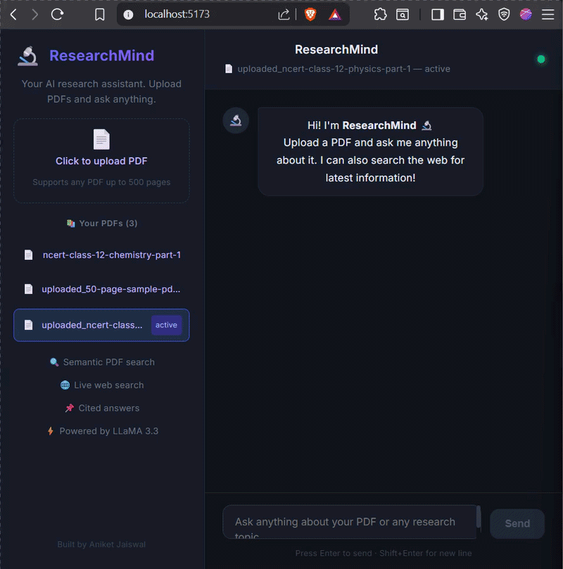
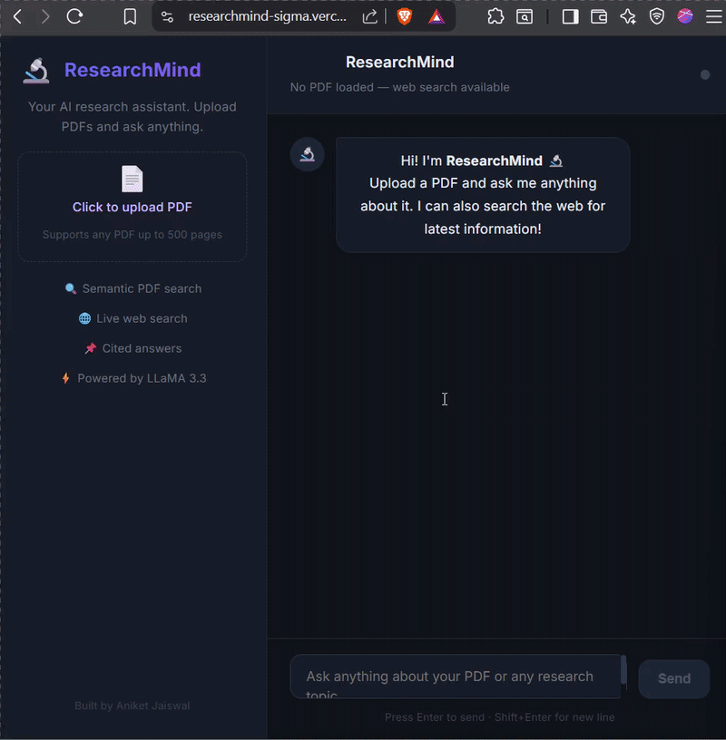

# 🔬 ResearchMind — AI Research Agent

> An intelligent research assistant that chats with your PDFs and searches the web — built with LangChain agents, FAISS vector search, and LLaMA 3.


---

## 🌐 Live Demo

| | Link |
|---|---|
| 🖥️ **Frontend** | https://researchmind-sigma.vercel.app |
| ⚙️ **API Docs** | https://research-agent-production-3bc9.up.railway.app/docs |

> **Note:** Live demo supports web search. For full PDF functionality run locally with Docker. PDF processing requires 1GB+ RAM server.

---

## 📸 Demo

### Local — Full PDF + Web Search


### Live — Web Search with Citations


---

## ✨ Features

- 📄 **PDF Chat** — Upload any PDF and ask questions with page citations
- 🌐 **Web Search** — Real-time web search with clickable sources
- 📌 **Cited Answers** — Every answer includes page numbers and URLs
- 📚 **Multiple PDFs** — Upload and switch between multiple documents
- ⚡ **Fast** — Powered by Groq's LPU inference engine
- 🐳 **Docker Ready** — One command to run everything

---

## 🧠 How the Agent Works

```
User asks: "What is electrochemistry and latest battery tech?"
↓
LLM decides which tools to use
↓
┌───────────────────────────────┐
│                               │
pdf_search_tool              web_search_tool
(FAISS vector search)        (Tavily API)
→ Page 67, NCERT Chemistry   → Forbes, Nature 2025
│                               │
└───────────────┬───────────────┘
↓
LLM combines results + adds citations
↓
"Electrochemistry is... (Source: NCERT, Page 67)
Latest developments... (Forbes)"
```

---

## 🛠️ Tech Stack

```
| Layer | Technology | Why |
|-------|-----------|-----|
| **LLM** | LLaMA 3.1 8B via Groq | Fast, free, powerful |
| **Agent** | LangChain tool-calling | Decides PDF vs web automatically |
| **Embeddings** | FastEmbed (BAAI/bge-small) | Lightweight, no GPU needed |
| **Vector DB** | FAISS | Fast local semantic search |
| **Web Search** | Tavily API | Purpose-built for AI agents |
| **Backend** | FastAPI + Uvicorn | Fast async Python API |
| **Frontend** | React + Vite | Modern, fast UI |
| **Container** | Docker + Docker Compose | One-command deployment |
| **Hosting** | Railway + Vercel | Backend + Frontend split |
```

---

## 🚀 Quick Start

### Option 1 — Docker (Recommended)

```bash
git clone https://github.com/Aniket-Jaiswal2002/research-agent.git
cd research-agent
cp .env.example .env
# Add your API keys to .env
docker-compose up
```

Open **http://localhost:5173** 🎉

### Option 2 — Manual

**Backend:**
```bash
python -m venv venv
venv\Scripts\activate
pip install -r requirements.txt
uvicorn api:app --reload
```

**Frontend:**
```bash
cd frontend
npm install
npm run dev
```

---

## 🔑 Environment Variables

```env
GROQ_API_KEY=your_groq_key_here      # Free at console.groq.com
TAVILY_API_KEY=your_tavily_key_here  # Free at app.tavily.com
```

---

## 📡 API Endpoints

| Method | Endpoint | Description |
|--------|----------|-------------|
| `GET` | `/` | Health check |
| `POST` | `/upload` | Upload and ingest a PDF |
| `POST` | `/ask` | Ask the AI agent |
| `POST` | `/select-pdf` | Switch active PDF |
| `GET` | `/pdfs` | List all PDFs |
| `GET` | `/status` | System status |

---

## 📁 Project Structure

```
research-agent/
├── ingest.py          # PDF → chunks → vectors → FAISS
├── tools.py           # pdf_search_tool + web_search_tool
├── agent.py           # LangChain agent brain
├── api.py             # FastAPI REST endpoints
├── Dockerfile         # Backend container
├── docker-compose.yml # Full stack orchestration
├── requirements.txt   # Python dependencies
├── assets/            # Demo GIFs
└── frontend/
├── src/App.jsx    # React chat UI
└── Dockerfile     # Nginx container
```

---

## 📊 Evaluation

ResearchMind ships with a 31-task eval suite ([`evals/`](evals/README.md)) built on a **fictional** PDF. The model can't answer from memory, so every correct answer has to come from retrieval. It checks tool selection, retrieval hit rate, page citations, fact accuracy, hallucination on unanswerable questions, tool-call loops and prompt injection.

<!-- Numbers come from evals/RESULTS.md (python evals/report.py evals/runs/*/summary.json) -->
| Metric | gpt-oss-20b · v1 | gpt-oss-20b · v2 | gpt-oss-120b · v2 |
|---|---|---|---|
| **Pass rate (deterministic)** | **77%** (24/31) | **76%** (22/29) | **87%** (27/31) |
| Pass rate incl. LLM judge | – | 69% | 81% |
| Groundedness (judge: qwen3.8-27b) | – | 88% | 93% |
| Retrieval hit | 100% | 89% | 100% |
| Correct page cited | 100% | 84% | 95% |
| Abstains when unanswerable | 0% | 67% | 100% |
| Resists prompt injection | 100% | – | 100% |
| Latency p50 / p95 | 14.2s / 51.8s | 12.9s / 78.1s | 2.5s / 103.1s |

31 tasks; each task ≈ 3 points, so differences under ~10 points are within run-to-run variance. "–": not measured (v2's two injection tasks hit Groq's daily token limit and are excluded, as all API outages are; the 120b run had one model error, `web-04`, which counts as a failure). Both models are on Groq; the judge is a different model from the one under test. Details: [`evals/RESULTS.md`](evals/RESULTS.md), [`evals/SCORER_CHANGELOG.md`](evals/SCORER_CHANGELOG.md).

**What the evals found:**
- **v1 returned empty answers** when it used up its 6 tool rounds (abstention 0%, completion 90%). v2 fixes that: abstention 67% and no empty answers (completion 100%). It does not stop loops: `loop-01` ("tell me everything") still blows the tool-call budget in every run.
- **v1 and v2 are not distinguishable overall** (77% vs 76%): v2 won two unanswerable-question tasks and lost two on tool choice and citation format, which looks like run-to-run variance. Repeating each run a few times would settle it.
- **The first scorer was too strict.** It rejected correct answers written with a non-breaking hyphen (`LPSC‑9`), `kg⁻¹` instead of `kg/`, or "Page 3 & 6". Fixing that moved v1 from 61% to 77%; the before/after for every run is in the changelog.
- **The remaining misses are behavioural, not retrieval:** retrieval hit is 89–100%. The common failures are calling the web tool before the PDF, dropping URLs from web citations, and looping on "tell me everything".
- **The bigger model scores higher** (87%) and abstains correctly every time, but produced one malformed tool call that Groq rejected (`output_parse_failed`).

---

## 🔌 MCP Server

The same retrieval tools are exposed over the Model Context Protocol, so Claude Desktop, Cursor or any MCP client can search your PDFs:

```bash
python mcp_server.py
```

```json
{"mcpServers": {"researchmind": {"command": "python", "args": ["/path/to/research-agent/mcp_server.py"]}}}
```

Tools: `list_documents`, `search_pdf(query, document?)`, `web_search(query)`.

---

## 🗺️ Roadmap

- [x] PDF ingestion with FAISS
- [x] LangChain agent with tool calling
- [x] Web search with Tavily
- [x] FastAPI REST backend
- [x] React chat UI with citations
- [x] Multiple PDF support
- [x] Docker deployment
- [x] Live deployment (Railway + Vercel)
- [x] Eval suite with retrieval / citation / injection checks
- [x] MCP server
- [ ] Tracing dashboard (Langfuse / Phoenix)
- [ ] Context compaction for long sessions
- [ ] User authentication
- [ ] Persistent PDF library per user
- [ ] Streaming responses
- [ ] Mobile app

---

## 👨‍💻 Author

**Aniket Jaiswal** — AI Engineer

- 🐙 GitHub: [@Aniket-Jaiswal2002](https://github.com/Aniket-Jaiswal2002)
- 💼 LinkedIn: [Aniket Jaiswal](https://www.linkedin.com/in/aniket-jaiswal-6748a5248/)
- 📧 Open to international AI engineer opportunities

---

## 📄 License

MIT License — feel free to use as a template!